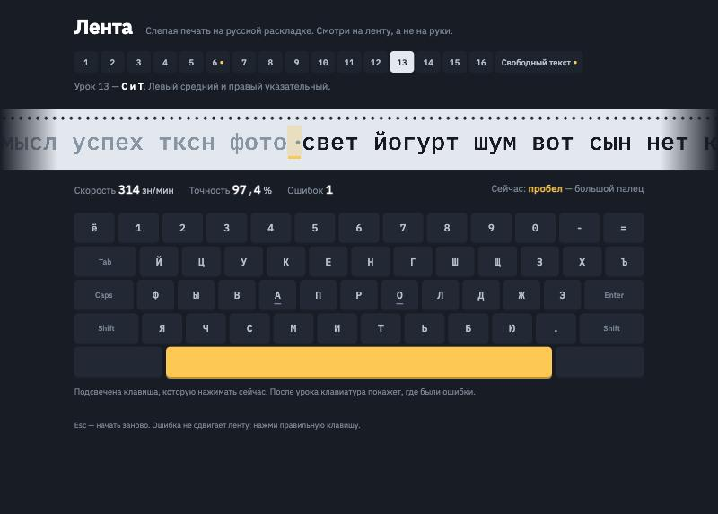
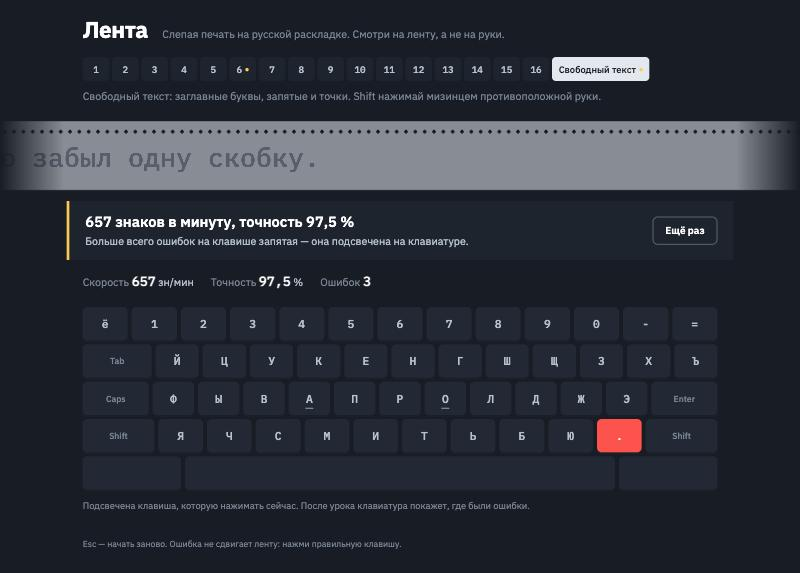

# Лента

Тренажёр слепой печати на русской раскладке. Текст едет лентой, как на телетайпе:
курсор стоит на месте, лента сдвигается под ним, поэтому взгляд не прыгает по строке.

**Попробовать:** https://ex3ittt.github.io/typing-tape/



## Как учит

- **16 уроков по рядам клавиатуры.** Сначала только А и О, на них указательные пальцы.
  Потом В и Л, Ы и Д, и так далее, пока не наберётся весь алфавит. Каждый урок
  составляется заново из **настоящих слов**, где есть только пройденные буквы:
  «вол», «пол», «дробь», «правда». Пока слов мало, их дополняют слоги из новых букв.
- **Ошибка не двигает ленту.** Нужно нажать правильную клавишу, как в классических
  курсах. Неверно набранный символ подкрашивается, и в конце видно, где были ошибки.
- **Подсказка, каким пальцем.** На экранной клавиатуре горит нужная клавиша, а
  внизу написано: «Сейчас: о — правый указательный». Для заглавных подсвечивается Shift
  **другой** рукой.
- **Карта ошибок.** После урока клавиши краснеют пропорционально доле ошибок.
  В итоге написано, на каких клавишах их больше всего:



- Скорость считается в **знаках в минуту**, как принято в русских тренажёрах, а не в словах.
- Если включена английская раскладка, тренажёр так и скажет, вместо того чтобы
  молча засчитывать ошибки.
- Лучший результат по каждому уроку сохраняется в браузере и отмечен точкой у номера урока.

## Как устроено

```
src/
  layout.ts    ЙЦУКЕН: клавиши, Shift-символы, какой палец за что отвечает
  lessons.ts   уроки и генератор упражнений из разрешённых букв
  words.ts     словарь и связные тексты
  session.ts   прохождение текста: нажатия, ошибки, скорость, карта ошибок
  main.ts      лента, экранная клавиатура, ввод
tests/         13 тестов на Vitest
```

`session.ts` — чистые функции: `press(session, key, time) → session`.
Интерфейс только передаёт в них нажатия и рисует результат. Поэтому правила
(ошибка не сдвигает курсор, точность учитывает каждое неверное нажатие, разные
кавычки считаются одной клавишей) проверяются тестами без браузера.

Генератор проверен на всех 16 уроках: в упражнении нет ни одной буквы, которую ещё
не проходили, а новые буквы встречаются заметно чаще старых.

## Запуск

```bash
npm install
npm run dev
npm test
```

## Стек

TypeScript, Vite, Vitest, без фреймворков. Шрифты IBM Plex Mono и IBM Plex Sans.
GitHub Actions собирает проект и выкладывает его на GitHub Pages.
